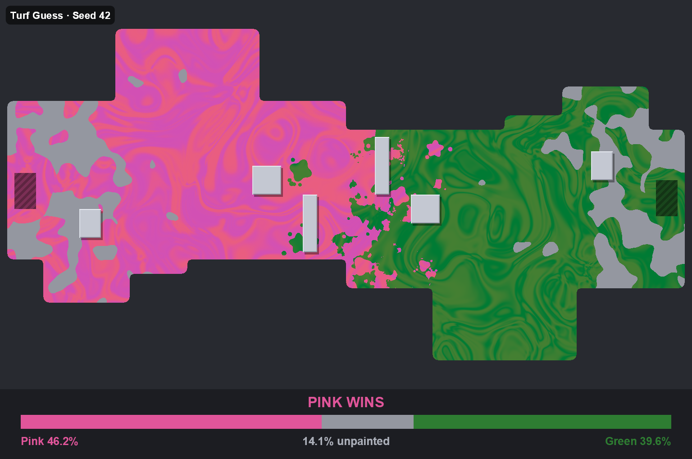

# Turf Guess

A daily guessing game for Discord. Every day the bot posts a procedurally generated arena where two colors of paint have fought over the floor. Players click the color they think covered more. The next day the bot reveals the exact percentages and posts a new arena.



**Status:** the arena, paint and image generator is done, and you can try it with the Preview tool. The Discord bot itself isn't built yet.

## Documentation

| Document | For | What's in it |
|---|---|---|
| [User Guide](docs/USER_GUIDE.md) | Players and server admins | How to play, reading an arena, all Preview tool options |
| [Developer Guide](docs/DEVELOPER_GUIDE.md) | Contributors | Architecture, the generation pipeline, options reference, testing, common changes |
| [DESIGN.md](DESIGN.md) | Everyone planning ahead | The full spec: decisions, the planned bot, data model, configuration |

## Quick start

Requires the .NET 10 SDK.

```bash
dotnet test
dotnet run --project src/TurfGuess.Preview -c Release
```

The Preview app writes sample rounds, reveals and a contact sheet to `preview/`.
