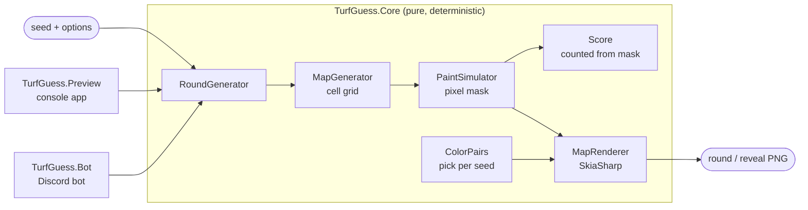
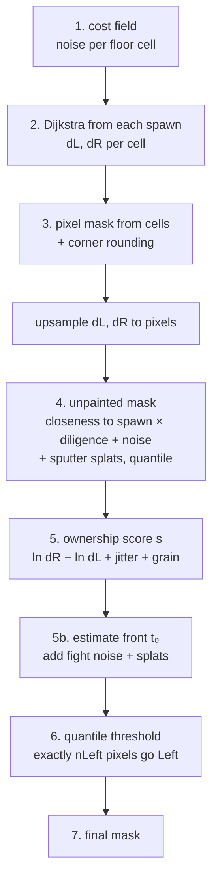
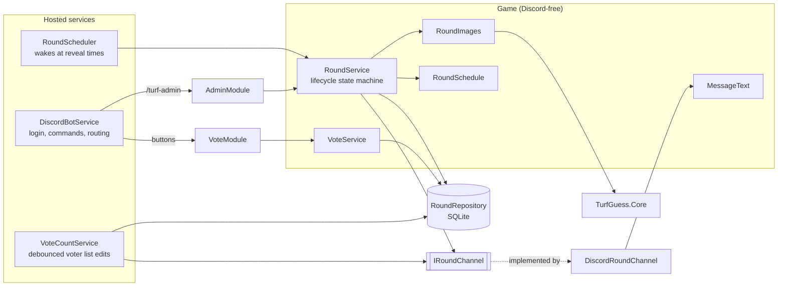

# Turf Guess: Developer Guide

How Turf Guess works and how to change it. For what the game does and how to use the Preview tool, see the [User Guide](USER_GUIDE.md). For design decisions and the planned bot behaviour, see the spec, [DESIGN.md](../DESIGN.md).

---

## Overview

Turf Guess turns a **seed** (a 64-bit number) into a **round**:

1. a symmetric arena,
2. a paint mask in which one team covers an exact, chosen share of the floor,
3. a score counted from that mask,
4. images: the round image to post, and a reveal image.

All of this lives in **`TurfGuess.Core`**, a pure, deterministic library with no Discord or database code. The same seed and options always give the same round. Two apps sit on top of it: the Preview console app and the Discord bot.



| Project | Status | Role |
|---|---|---|
| `src/TurfGuess.Core` | ✅ | Map generation, paint, scoring, rendering, color pairs |
| `src/TurfGuess.Preview` | ✅ | Console app that writes sample rounds and contact sheets |
| `src/TurfGuess.Bot` | 🟡 Built, not yet run live | Discord bot: scheduler, round lifecycle, voting buttons, SQLite, reveals, admin commands |
| `tests/TurfGuess.Core.Tests` | ✅ | xUnit tests for Core (77 tests) |
| `tests/TurfGuess.Bot.Tests` | ✅ | xUnit tests for the bot's game logic, data, text and logs (45 tests) |

**The one rule to remember:** the **paint mask** is the single source of truth. The score is counted from it and the renderer only draws it. Nothing visual may ever change what's counted.

---

## Getting started

**Requirements:** the .NET 10 SDK. SkiaSharp brings its own native binaries on Windows. The bot also references `SkiaSharp.NativeAssets.Linux` for Linux hosts.

```bash
dotnet build                                   # whole solution
dotnet test                                    # 122 tests (77 Core + 45 Bot), ~10 s
dotnet run --project src/TurfGuess.Preview -c Release -- --count 12 --seed 42
```

Use `-c Release` for the Preview app. Generation is noticeably slower in Debug.

### Repository layout

```
TurfGuess/
  DESIGN.md                      # the spec: decisions, behaviour, data model, config
  TurfGuess.slnx                 # .NET 10 XML solution
  docs/                          # this guide + the user guide
  src/
    TurfGuess.Core/
      GeneratorOptions.cs        # all generation options + validation
      RoundGenerator.cs          # seed + options -> GeneratedRound (entry point)
      Grid/                      # Grid<T>, CellType, Side, RectI, Symmetry
      MapGen/                    # MapGenerator, GameMap
      Paint/                     # PaintSimulator, CornerRounding, PaintResult
      Scoring/                   # Score, ScoreResult, DifficultyRank
      Render/                    # MapRenderer, RenderStyle, ColorPairs, ColorMath
      Noise/GradientNoise.cs     # seeded Perlin-style noise + fBm
      Util/Rng.cs                # SplitMix64 PRNG
    TurfGuess.Preview/Program.cs
    TurfGuess.Bot/                 # Discord bot (see "The bot" below)
  tests/TurfGuess.Core.Tests/
  tests/TurfGuess.Bot.Tests/
  preview/                       # Preview output (git-ignored)
```

---

## The pipeline in detail

### Entry point: `RoundGenerator.Generate(seed, options)`

```csharp
var round = RoundGenerator.Generate(seed, new GeneratorOptions());
var style = ColorPairs.Pick(seed);                    // colors for this round
using var image = MapRenderer.RenderRound(round, style, caption: "Round #12");
byte[] png = MapRenderer.EncodePng(image);
```

`Generate`:
1. **Validates** the options. Invalid options throw `ArgumentException` with every problem listed.
2. Draws the **round-level choices** from their own random stream (`Rng.Derive(seed, 0xD1FF)`): which side wins (50/50), the target winner share (uniform in `[MinWinnerShare, MaxWinnerShare]`) and the target unpainted share (uniform in `[UnpaintedMin, UnpaintedMax]`). Because these come from their own stream, they stay the same however many attempts the map needs.
3. Tries **attempts** until one succeeds. Attempt `a` uses map seed `Derive(seed, 2a+1)` and paint seed `Derive(seed, 2a+2)`. The map generator retries internally too, and the paint step can reject a result (see its sanity checks).
4. Returns a `GeneratedRound`: seed, `GeneratorVersion`, winner, targets, attempt count, map, paint mask and score.

### Determinism

- **`Rng`** is SplitMix64. It's used instead of `System.Random` so that output never depends on the runtime's implementation. `Rng.Derive(seed, salt)` makes independent sub-seeds without consuming state.
- **`GradientNoise`** is our own Perlin-style noise with fBm, seeded through `Rng`, instead of a third-party library.
- **`GeneratorVersion`** (in `RoundGenerator`) must be **bumped whenever a change alters what a given seed produces**. The bot will store it with each round, so old rounds can be told apart. Current version: **4**.
- Floating-point math (`Math.Log`, `Math.Exp`, …) is deterministic on a given platform. It may differ in the last bits across CPU architectures, which is why the bot stores each round's result and image instead of regenerating them.

### Stage 1: map generation (`MapGen/MapGenerator.cs`)

Works on a **cell grid**, by default 96×54. Cell types: `Void`, `Floor`, `Wall`, `SpawnLeft`, `SpawnRight`. Only the **left half** is generated. Symmetry then produces the right half.

| Step | Details |
|---|---|
| Bounds | Left half, with a one-cell void border around the map |
| **Spine** | One band from the left edge to the center line. Height 30–48% of the grid, shifted off the middle row by up to ±1/9 of the height. Its overlap with its own rotated copy is the main crossing. |
| **Wings** | 2–4 rectangles (20–45% of the half's width, 15–35% of the height) hanging off the top or bottom of the spine, overlapping it by at least 4 cells, so the body is always connected |
| **Center plaza** | In 70% of maps: a rectangle at the center line, symmetric around the middle row, so it crosses the center in both symmetry modes |
| **Spawn** | A 3×5 pad at x=2 inside the spine, with a 9-cell-wide platform around it |
| **Holes** | 0–2 void rectangles (4–8 cells), kept away from the spawn platform |
| **Obstacles** | Up to `MaxObstaclesPerHalf` (4), until `ObstacleDensity` × floor is covered. 75% are blocks of 2–4 × 2–4 cells, 25% are straight walls 4–8 long and 1–2 thick. Each needs a one-cell ring of floor (no slivers against the outline) and a 3-cell gap to other obstacles. |
| Snap | Spine, wings, plaza and holes snap to a **2-cell step** |
| **Symmetry** | `Symmetry.Apply`: `Rotate` maps `(x, y) → (w−1−x, h−1−y)`, and `Mirror` maps `(x, y) → (w−1−x, y)`. Spawn types are swapped. |
| **Validation** | Flood fill (4-connected) from the left spawn. Unreached floor becomes void, and walls not connected to a wall that touches reached floor become void (so the inner cells of big blocks survive). The map is rejected if the right spawn isn't reached, the walkable fraction is outside `[MinFloor, MaxFloor]`, or the center line has fewer than 4 crossing rows or more than 5 separate crossings. |

A rejected map retries with the next sub-seed, up to `MaxAttempts` (50) times, before throwing `MapGenerationException`.

### Stage 2: paint (`Paint/PaintSimulator.cs`)

Produces a **pixel mask** at `PixelsPerCell` (16) resolution, by default 1536×864. Each pixel is a `PixelKind`: `Void`, `Wall`, `Unpainted`, `Left`, `Right`, `SpawnLeft` or `SpawnRight`.



1. **Cost field.** For each walkable cell, `cost = exp(1.1 · fbm(x·0.09, y·0.09))`. Varying costs make paint flow faster through some areas, which gives finger-like borders.
2. **Distance fields.** An 8-connected Dijkstra from every cell of each spawn pad, with no corner cutting past walls, gives `dL` and `dR`. They're computed once and don't depend on the margin.
3. **Pixel mask and corner rounding.** Each pixel takes its cell's type, with floor as `Unpainted`. Then `CornerRounding.Apply` rounds the outline (see below), and `dL` and `dR` are bilinearly interpolated for every floor pixel, ignoring non-walkable neighbours.
4. **Unpainted mask.** The highest-`u` pixels become unpainted, so the floor **near spawns** gets neglected, broken into patches by the noise. The cut-off is a **quantile**, so the share lands exactly on target. This step doesn't depend on the margin.
   ```
   u = max(nL·(1 − dL/max), nR·(1 − dR/max)) + 0.7·holes + 0.06·jitter + 0.02·grain
   ```
   - **Diligence:** `n` is 1.0 for a normal team and 0.25 for a team that painted its spawn diligently. Each team is diligent with probability `DiligentSpawnChance` (30%), drawn from `Rng.Derive(paintSeed, 7)` and exposed as `PaintResult.DiligentLeft/Right`. The unpainted share then shifts to the other spawn, or toward the middle when both teams were diligent.
   - **Spawn trail:** pixels within a cost-distance of `2.5 · (1 + 0.8·jitter)` of a pad are never unpainted. The jitter makes the trail's edge ragged rather than a smooth ring.
   - **Sputters (4b):** `jitter` and `grain` make the paint/unpainted edge ragged. A preliminary quantile gives the estimated border `u₀`. Then 14–25 small splats (radius 0.35–0.9 cells, 3–7 droplets each) are stamped at pixels near a spawn (closeness ≥ 0.4) with `u₀ ≤ u < u₀ + 0.15`, setting `u = −∞` (forced painted). Only after that does the final quantile run.
5. **Ownership score.** For painted pixels, `s = ln(dR+1) − ln(dL+1) + 0.10·jitter + 0.035·grain`. Positive means closer to the left team.
   - **Fight zone (5b).** A preliminary threshold `t₀` for the target margin estimates where the front line will be. Then `0.9 · exp(−((s − t₀)/0.35)²) · fight-noise` is added, so both colors interleave in blotches across a band in the middle.
   - **Splats.** 28–45 stamps (wobbly circles with a radius of 0.6–1.5 cells, plus 2–5 droplets each), mostly placed where `|s − t₀| < 0.5`. Each one sets `s = t₀ ± 8`, so it shows its team's color wherever it lands.
6. **Exact threshold.** `nLeft = round(leftShare · nPainted)`. The painted pixels are sorted by `s`, and the top `nLeft` become `Left`, the rest `Right`. This is equivalent to biasing the teams' speed (`t = 2 ln b`), but it needs no search and is **exact to one pixel**.
7. **Sanity check.** The losing team must still have paint right next to its own spawn. Otherwise the result reads like a wipeout and the attempt is rejected.

#### Corner rounding (`Paint/CornerRounding.cs`)

This works like CSS `border-radius`, on the floor/void outline at pixel level:
- **Opening** (erode, then dilate) with a disk of radius `CornerRadius` rounds the **outer** corners.
- **Closing** (dilate, then erode) with a disk of radius `InnerCornerRadius` fills the **inner** corners.

"Solid" means anything that isn't void, so walls and spawn pads are never cut. Erosion and dilation use an **exact Euclidean distance transform** (Felzenszwalb & Huttenlocher, separable over columns then rows), so the cost doesn't depend on the radius. Pixels outside the image count as void.

Radii are in cells and must be **below 1**. An opening with radius *r* removes features narrower than 2*r*, and the generator can produce 2-cell-wide parts.

### Stage 3: scoring (`Scoring/Score.cs`)

`Score.Count(mask)` counts `Left`, `Right` and `Unpainted` pixels. Everything else isn't floor.

| Value | Formula | Used for |
|---|---|---|
| `WinnerShare` | `max(L, R) / (L + R)` | Difficulty. This is what `Min/MaxWinnerShare` control. |
| `CoverageLeft`, `CoverageRight` | `L / floor`, `R / floor` | The percentages shown at the reveal |
| `UnpaintedShare` | `U / floor` | Shown at the reveal |
| `Winner` | `L > R ? Left : Right` | Ties are impossible because `MinWinnerShare > 50` |

`Difficulty.RankFor(winnerShare)` (`Scoring/DifficultyRank.cs`) turns `WinnerShare` into a rank shown in the round message: X under 50.7%, S under 51.1%, A under 51.5%, B under 51.9%, otherwise C. The bands are fixed 0.4-point steps over the default 50.3–52.3% range, not derived from the configured range, so a rank always means the same split.

### Stage 4: rendering (`Render/MapRenderer.cs`)

`RenderRound` and `RenderReveal` return an `SKBitmap`, and `EncodePng` turns it into PNG bytes. Pixels are written into an `int[]` buffer (RGBA8888) and copied into the bitmap. SkiaSharp is used for text, the banner and encoding.

| Layer | Look |
|---|---|
| Void | Flat `#282A30` |
| Unpainted floor | Flat `#9497A0` (148, 151, 160) |
| Paint | Depends on the ink style (below) |
| Spawn pads | Team color at 42–55% brightness, diagonal stripes |
| Walls | Light grey top with a bevel: lighter top and left edges, darker bottom and right edges (`p/8` px) |
| Drop shadow | Pixels whose `(x − p/4, y − p/3)` neighbour is a wall are darkened to 62% |
| Caption | Optional rounded label at the top-left |
| Reveal banner | 18% of the image height: "X WINS", a coverage bar, labelled percentages |

#### Ink styles (`RenderStyle.Ink`)

| Style | How it works |
|---|---|
| **Marbled** (default) | **Domain-warped noise**: `q = fbm(p)`, `r = fbm(p + 2.2q)`, `v = fbm(p + 2.2r)`, at 1/16 cells. `sin(v · 1.4 · 2π)` gives a tone in [−1, 1], folded into swirled bands. |
| **Flat** | Tone 0 everywhere: one solid color per team |
| **Shaded** | Tone from broad swells (60%) plus a bump map lit from the top-left (40%), with gloss highlights, and cool shadow on borders |

Each tone is applied by `Ink.Shade` in **OKLCh** (`ColorMath`, Björn Ottosson's OKLab). Positive tones shift the hue toward yellow (100°) and lighten. Negative tones shift it toward blue (265°), darken and add a little chroma. Marbled uses a 15° hue shift and a ±0.015 lightness swing, so the bands differ mostly in hue.

**Yellow/green damping (Marbled only).** Yellow and green base colors turn olive when their hue shifts, so `MarbleHueShiftScale(baseHue)` reduces the shift to 35% for base hues between 90° and 150°, fading back to full strength by 65° and 175° with a cosine curve.

All tuning values are `private const` fields grouped by style in `MapRenderer.cs`: `Shade…`, `Marble…` and `Damp…`.

#### Color pairs (`Render/ColorPairs.cs`)

`ColorPairs.Default` holds three pairs: Pink/Green, Orange/Blue and Yellow/Blue. `ColorPairs.Pick(seed)` picks a pair, and which color goes left, from `Rng.Derive(seed, 0xC0102)`. Each `TeamStyle` has a `Name`, a hex `Color` and an `Emoji`, which goes on the vote button.

---

## The bot (`src/TurfGuess.Bot`)

A .NET Generic Host worker using **Discord.Net 3.20** (WebSocket + Interactions), **SQLite** through Microsoft.Data.Sqlite and **Dapper**. For setup and running it, see the [User Guide](USER_GUIDE.md#running-the-bot).

### Architecture

The game logic never touches Discord types. It talks to the chat platform through **`IRoundChannel`**, which has post, find, close and reveal methods. `DiscordRoundChannel` is the real implementation, and the tests use an in-memory `FakeChannel`.



### Startup (`Program.cs`)

1. Configuration: `appsettings.json` from the app folder, then user secrets, then `TURFGUESS_*` environment variables.
   - With `--preview-messages [--seed N] [--raw]`, `MessagePreview.Render` prints every message for a sample round and the app exits. It needs no token and makes no Discord connection. It uses the same `MessageText` as the live bot, so the preview can't drift from what's actually posted.
2. `BotOptionsValidator.Validate`. On any error, print every problem and exit with code 1.
3. Create the schema (`Database.EnsureSchema`, WAL mode).
4. Register the services and start three hosted services:
   - `DiscordBotService` logs in with `GatewayIntents.Guilds` only. On `Ready` it registers the slash commands to the channel's server (guild commands appear instantly) and completes `ChannelReadySignal`.
   - `RoundScheduler` waits for that signal, then loops: `next = RoundService.AdvanceAsync(now)`, then sleeps until `next`. It caps each sleep at 5 minutes, so a changed system clock can't make it oversleep, and wakes early when `SchedulerSignal.Wake()` is called. On an error it logs and retries after a minute.
   - `VoteCountService` edits the voter list ("N players have voted: @a, @b, …") at most once per `VoteCountInterval`, for rounds that got new votes. Voters come from `RoundRepository.GetVoterIds`, sorted by name rather than vote time: changing a vote updates `voted_at`, so time order would show who switched.

### The round lifecycle (`Game/RoundService.cs`)

`AdvanceAsync(now)` looks at the one unfinished round and takes the next step, until the round is `Open` and waiting for its reveal time:

| Current state | Step |
|---|---|
| No unfinished round | **Create:** new seed → `RoundGenerator.Generate` → `ColorPairs.Pick` → insert as `Pending` (`reveal_at` from `RoundSchedule`) → render and save both PNGs → store their paths |
| `Pending` | **Post:** `FindRoundMessageAsync`. If the message is already there (crash after sending), adopt it. Otherwise post it. Then mark `Open` with the message id. |
| `Open`, before `reveal_at` | Return `reveal_at` |
| `Open`, at or after `reveal_at` | Mark `Revealed`. **This is what closes voting.** |
| `Revealed` | **Reveal:** disable the buttons → `FindRevealMessageAsync`, adopting an existing reveal or posting one with the summary → mark `Done` |

Each database write happens **before** the Discord call it prepares for, and each Discord id is saved **after**. Every step is safe to repeat, so normal operation, catch-up after downtime and crash recovery all use the same loop. The "find" methods scan the bot's last 50 messages in the channel:
- the round message is found by its button id prefix, `vote:{roundId}:`,
- the reveal is found by its embed footer, `Round #{id} · Results`.

**The schedule** (`Game/RoundSchedule.cs`): `NextOccurrence(after, time, zone)` gives the next moment the clock in `zone` shows `time`. Times skipped by a daylight-saving jump move to the first valid time. `RevealAt` adds the first-round rule: if the first round would be shorter than `MinRoundLength`, it skips one day.

### Voting

- **Buttons** have custom id `vote:{roundId}:{left|right}`. `VoteModule` handles them with `[ComponentInteraction("vote:*:*")]`. Discord.Net routes clicks by that id, so the buttons keep working across restarts with no state to restore.
- **`RoundRepository.TryUpsertVote`** inserts or changes the vote **only if the round is `Open`**, in a single SQL statement (`INSERT … SELECT … WHERE EXISTS (… status = 'Open') ON CONFLICT DO UPDATE`). SQLite runs writes one at a time, so a vote can never slip in after the round moved to `Revealed`. Disabled buttons are only a visual cue.
- Replies are **ephemeral**, so only the voter sees them.

### Messages (`Game/MessageText.cs` + `Discord/DiscordRoundChannel.cs`)

- **Round message:** an embed with a title, a description with `<t:unix:R>` timestamps (each client shows them in its own time zone), an attached PNG and the footer `Round #{id}`, plus two grey buttons with the team emoji and name. Every edit (voter list, closing) builds the embed from scratch with the image as `attachment://round_{id}.png`. Copying the existing embed would bring the image back as a CDN link, and Discord would then show the attachment a second time above the embed.
- **Reveal:** an embed in the winner's color, with the winner, coverage, unpainted share and vote counts, the correct guessers as `<@id>` mentions, the reveal PNG and the footer `Round #{id} · Results`. It's sent with **`AllowedMentions.None`**, so names render but nobody is pinged. The list stops at `MaxListedWinners` and within 2000 characters ("…and N more"). The voter list on the round message uses the same mentions, capped at 50 names and the 4096-character embed limit.

### Logging

Standard `ILogger` with message templates, so the values are structured fields (`{RoundId}`, `{UserName}`, `{Team}` …) for any structured log sink added later. The console uses the simple formatter, with one line per entry and a timestamp (`Program.cs`). Percentages are formatted with the invariant culture, so logs read the same on every machine.

| Where | What |
|---|---|
| `RoundService.CreateRound` | Colors, seed, **the answer** (winner and coverage), reveal time in the configured time zone |
| `RoundService.PostAsync` | Channel id, message id, colors, voting deadline. Adopted messages after a restart are logged too. |
| `RoundService.AdvanceAsync` | Voting closed, with the vote count |
| `RoundService.LogRevealStats` | One entry with the winner, coverage, votes per team, and correct guessers by username (capped at 50 names). Logged on a normal reveal and when an existing reveal is adopted. |
| `VoteService.Cast` | Every click: first vote, changed vote (old → new team), repeat, or rejected because voting closed. Who voted comes from `user_name`, which is stored with each vote and updated on every click. |
| `AdminModule` | Who ran which admin command, and what happened |
| `DiscordBotService` | Discord.Net's own log messages, mapped to `ILogger` levels |

`votes.user_name` was added after the first release. `Database.EnsureSchema` adds the column to older databases (`AddColumnIfMissing`), so upgrading needs no manual step.

### Discord ids and time in the database

Snowflakes are `ulong` in Discord.Net and `INTEGER` (signed 64-bit) in SQLite. The repository works with `long`, and the code casts at the edges. This is safe because current snowflakes are far below 2^63. Times are Unix seconds. Seeds are kept below 2^63 for the same reason.

---

## Options reference

All options are mutable classes, so the bot can bind them from `appsettings.json` (DESIGN.md §7). `GeneratorOptions.Validate()` enforces the ranges below.

**`MapOptions`**

| Option | Default | Valid range | Meaning |
|---|---|---|---|
| `GridWidth` | 96 | even, ≥ 16 | Cells across |
| `GridHeight` | 54 | ≥ 16 | Cells down |
| `Symmetry` | `Rotate` | `Rotate`, `Mirror` | How the right half is made |
| `ObstacleDensity` | 0.03 | 0–0.3 | Target fraction of floor covered by obstacles |
| `MaxObstaclesPerHalf` | 4 | 0–20 | Hard cap on obstacles |
| `MinFloor` / `MaxFloor` | 0.45 / 0.70 | 0 < min < max < 1 | Allowed walkable fraction of the grid |
| `MaxAttempts` | 50 | ≥ 1 | Sub-seeds to try |

**`PaintOptions`**

| Option | Default | Valid range | Meaning |
|---|---|---|---|
| `UnpaintedMin` / `UnpaintedMax` | 0.03 / 0.10 | 0 ≤ min ≤ max < 0.5 | Unpainted share of the floor, picked per round |
| `Splatter` | true | | Splats in the fight zone and sputters at the unpainted border near spawns |
| `DiligentSpawnChance` | 0.3 | 0–1 | Per team, per round: chance it painted its own spawn area diligently |
| `PixelsPerCell` | 16 | 2–64 | Mask and image resolution |
| `CornerRadius` | 0.75 | 0–<1 | Outer corner radius, in cells |
| `InnerCornerRadius` | 0.5 | 0–<1 | Inner corner radius, in cells |

**`DifficultyOptions`**

| Option | Default | Valid range | Meaning |
|---|---|---|---|
| `MinWinnerShare` / `MaxWinnerShare` | 50.3 / 52.3 | 50 < min ≤ max < 100 | Winner's share of the painted floor, in % |

**`RenderStyle`** (not validated, set per round)

| Option | Default | Meaning |
|---|---|---|
| `GameName` | "Turf Guess" | Used in captions |
| `Ink` | `Marbled` | `Flat`, `Shaded`, `Marbled` |
| `Left` / `Right` | Orange / Blue | Normally set by `ColorPairs.Pick` |

---

## Testing

```bash
dotnet test
```

| File | Covers |
|---|---|
| `MapGeneratorTests` | Same seed gives the same map; different seeds differ; both symmetry modes exact; every walkable cell reachable from both spawns; floor fraction and spawn placement |
| `RoundGeneratorTests` | Counted winner share = target (±1 pixel); unpainted share = target; identical masks per seed; both sides win across seeds; coverage adds up; walls, void and spawns don't count; invalid difficulty rejected; renderer outputs PNGs of the right size |
| `CornerRoundingTests` | Distance transform vs brute force; square corners cut; L-shaped corners filled; radius 0 is a no-op; 2-cell corridor survives the max radius; spawns never cut; rounded rounds still hit the target |
| `SpawnPaintTests` | Diligence chance 0/1 controls the flags; mix at the default; diligent teams leave less unpainted floor near spawn; targets unaffected; invalid chance rejected |
| `ColorPairsTests` | Pairs valid and distinct; pick is deterministic; all pairs and both sides used; empty list rejected |
| `MarbleDampingTests` | Yellow/green damped; other hues full; smooth fade |
| `DifficultyRankTests` | Rank boundaries, X to C |

**Bot tests** (`tests/TurfGuess.Bot.Tests`). Each one runs against a fresh SQLite file and image folder in a temp directory (`TestEnvironment`), with `FakeChannel` standing in for Discord:

| File | Covers |
|---|---|
| `RoundServiceTests` | First start creates and posts a round; nothing happens before the reveal time; reveal plus next round at the round time; correct guessers (including changed votes); votes rejected after reveal; multi-day downtime reveals once and posts one round; **a crash right after posting a round or a reveal never posts it twice**; missing images regenerated; `RevealNow` |
| `RoundScheduleTests` | Today vs tomorrow; catch-up rounds are shorter; 25-hour and 23-hour rounds across daylight-saving changes; skipped times; the first-round minimum |
| `RepositoryTests` | Round round-trip; only one unfinished round; status only moves forward; votes only while open and changeable; large snowflakes; repeatable schema creation |
| `LoggingTests` | Posting, every kind of vote (first, changed, repeat, rejected) and the reveal stats are logged; old databases get the `user_name` column |
| `MessagePreviewTests` | The preview shows every message, resolves mentions and timestamps, and `--raw` keeps the markup |
| `MessageAndOptionsTests` | Reveal text (winner, coverage, votes, mentions, cut-off, 2000-character limit, no votes); round description; button ids; config validation |

Round tests run at `PixelsPerCell = 4` to stay fast. The math doesn't depend on resolution. Internals are visible to the test project via `InternalsVisibleTo`.

**Visual checks** aren't automated. Use the Preview app, and compare `contact_sheet.png` before and after a change.

---

## Common changes

**Tweak how paint or the map looks**
Change the `private const` values at the top of `PaintSimulator.cs`, `MapGenerator.cs` or the relevant section of `MapRenderer.cs`, then check with the Preview app. If the change affects what a seed produces (map or mask, not just colors), **bump `GeneratorVersion`**.

**Add or change a color pair**
Edit `ColorPairs.Default`. Keep names and emoji distinct within a pair, and update the count in `ColorPairsTests`. Preview candidates first with `--pairs --pairs-file`.

**Add an ink style**
1. Add a value to `InkStyle`.
2. Add a branch to the `style.Ink switch` in `MapRenderer.RenderMap` that returns `(tone, gloss)` arrays.
3. Optionally give it its own `Ink` hue and lightness profile.

**Add a generation option**
1. Add a property with a default to the right options class.
2. Add a check to `Validate()`.
3. Use it in the generator.
4. Bump `GeneratorVersion` if the default changes the output.
5. Document it here and in DESIGN.md §7.

**Performance**
A round takes about 250–450 ms at 1536×864 in Release: the two Dijkstra runs, two sorts over the ~700k floor pixels, four distance transforms and the marble noise (5 fBm calls per paint pixel). The bot only needs one round per day.
