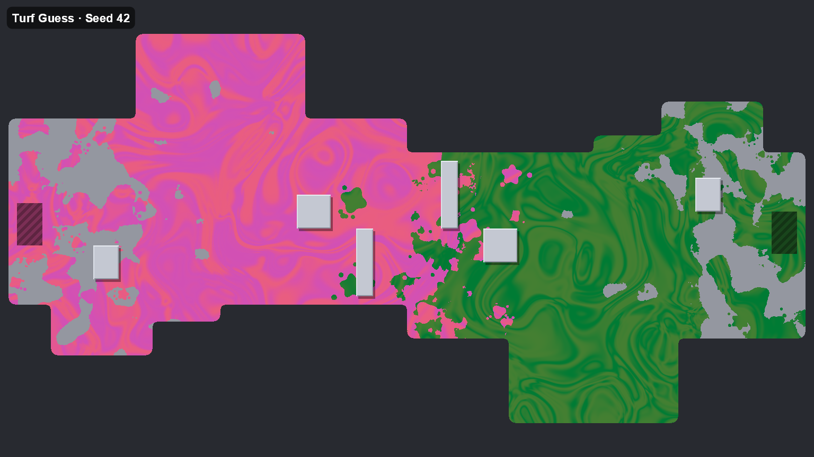
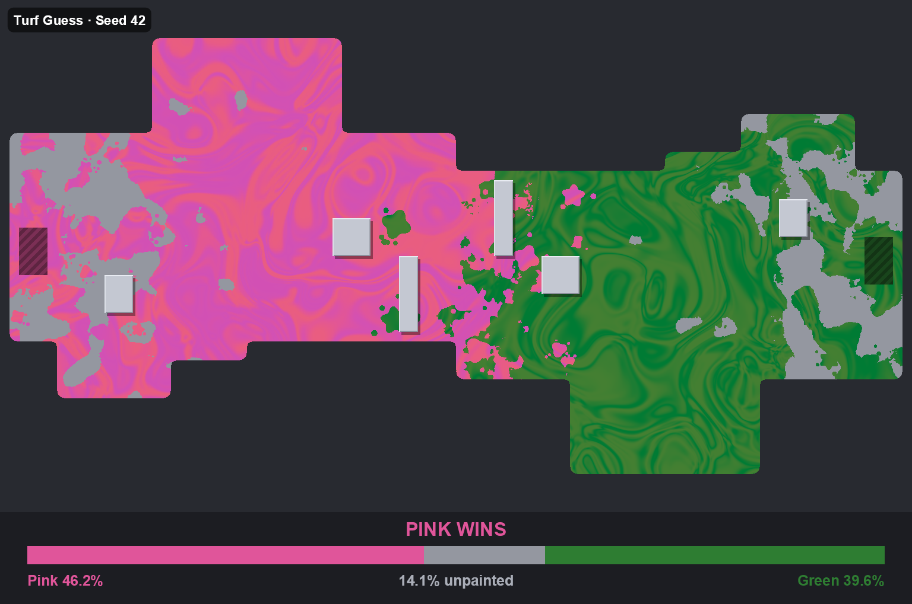

# Turf Guess: User Guide

This guide covers what Turf Guess does, how to play, and how to use the tools that are available today. For how it works under the hood, see the [Developer Guide](DEVELOPER_GUIDE.md).

---

## Overview

**Turf Guess** is a daily guessing game for a Discord server.

Every day the bot posts a picture of an arena. Two teams of paint have flowed in from opposite sides, one from the left and one from the right, and fought over the middle. One color covers slightly more floor than the other. **Your job is to guess which color won.** You vote with a single button click. At the same time the next day, the bot reveals the exact percentages, lists who guessed right, and posts the next arena.

What makes it fun:
- **It's close.** The winning color covers only 50.5–54% of the painted floor, so you really have to look.
- **No two rounds are alike.** Every arena, paint pattern and color pair is generated from scratch.
- **It's quick.** One look, one click, once a day.

### Current status

| Part | Status |
|---|---|
| Arena and paint generator | ✅ Done |
| Round and reveal images | ✅ Done |
| **Preview tool** for generating sample images on your own computer | ✅ Done |
| The Discord bot itself (daily posts, voting, reveals) | 🚧 Not built yet |

The [How to play](#how-to-play) section describes the game as it's designed. The [Preview tool](#the-preview-tool) section is what you can use right now.

---

## How to play

> **Note:** this describes the planned Discord bot. It isn't available yet.

1. **Every day at the round time** (for example 09:00), the bot posts a new arena in the game channel, with two buttons, one per team color, e.g. `🩷 Pink` and `💚 Green`.
2. **Click the color you think covers more floor.** Only you see your vote: the bot confirms it with a message nobody else can see. Nobody can see how others voted, so you can't just follow the crowd.
3. **Changed your mind?** Click the other button. Your latest click counts, right up until the reveal.
4. **At the next round time**, voting closes and the bot posts the result:
   - the winning color,
   - each color's share of the floor, plus how much was left unpainted,
   - how many people voted for each color,
   - the names of everyone who guessed right. Names are shown without pinging anyone.
5. The next arena is posted straight away.

Each round runs from one round time to the next, which is normally 24 hours.

### Reading an arena



| What you see | What it is |
|---|---|
| Two colors of paint | The two teams. Each team's name is simply its color. |
| Grey floor | Unpainted floor. It still counts as floor, but for neither team. |
| Dark background | Out of bounds. It doesn't count. |
| Light grey blocks with a shadow | Obstacles. Paint can't go on or under them, and they don't count. |
| Striped rectangle at each end | The spawn pads where each team started. They don't count. |
| A mixed band in the middle | Where the teams fought. Both colors interleave here. |

**How the winner is decided:** only paintable floor counts. Obstacles, out of bounds and spawn pads are left out. The color with more painted floor wins.

**Tips:**
- The map is **symmetric** (rotated 180°), so neither team has a better side.
- Players rush forward, so the floor near each team's own spawn is often left **unpainted**, with stray splats and droplets around the edges. Don't let a big grey patch on one side fool you.
- Sometimes a team **painted its spawn diligently**, so its side is almost fully painted and the grey patches end up on the other side. A tidy spawn doesn't mean that team won.
- The middle is messy on purpose. Look at the overall area, not just the front line.

### The reveal



The reveal shows the same arena with a banner underneath:
- **"PINK WINS"**, or whichever color won.
- A **bar** split into the first color, unpainted floor and the second color, sized by how much floor each one covers.
- The exact percentages, e.g. *Pink 46.2% · 14.1% unpainted · Green 39.6%*.

The percentages are shares of the **whole floor**, unpainted included, so they don't add up to 100% between the two colors. The winner is still simply the color with the bigger number.

### Team colors

Each round uses one of three color pairs, picked at random:

| Pair | Colors |
|---|---|
| 🩷 Pink vs 💚 Green | `#E0559A` / `#2E7D32` |
| 🧡 Orange vs 💙 Blue | `#DE6624` / `#343BC4` |
| 💛 Yellow vs 💙 Blue | `#D0BE08` / `#3A0CCD` |

Which color starts on the left is random too.

---

## The Preview tool

The Preview tool generates sample rounds on your own computer, with no Discord involved. Use it to see what rounds look like, compare settings, or test your own guessing.

### Requirements

- The **.NET 10 SDK** ([download](https://dotnet.microsoft.com/download)).
- This repository, checked out locally.

### Quick start

Open a terminal in the project folder (the one that contains `TurfGuess.slnx`).

**PowerShell:**
```powershell
cd D:\Documents\HobbyProjects\TurfGuess
dotnet run --project src\TurfGuess.Preview -c Release
```

**Bash / Git Bash:**
```bash
cd /d/Documents/HobbyProjects/TurfGuess
dotnet run --project src/TurfGuess.Preview -c Release
```

This generates 12 rounds and writes them to the `preview` folder:

| File | What it is |
|---|---|
| `round_<seed>.png` | The image the bot would post |
| `reveal_<seed>.png` | The matching reveal image |
| `contact_sheet.png` | All rounds side by side, labeled with seed, colors and the winning share |

It also prints a table in the terminal:

```
  seed try winner      target  actual  L cov  R cov    unp dil     ms
    42   1 Pink       53.85 % 53.85 % 46.2 % 39.6 % 14.1 %   -    639
```

| Column | Meaning |
|---|---|
| `seed` | The number the round was generated from. The same seed always gives the same round. |
| `try` | How many attempts the generator needed (normally 1). |
| `winner` | The winning color. |
| `target` / `actual` | The intended winning share of the painted floor, and the share actually counted. They always match. |
| `L cov` / `R cov` | Left and right team's share of the whole floor. |
| `unp` | Unpainted share of the floor. |
| `dil` | Which teams painted their own spawn diligently this round: `L`, `R`, `LR` or `-`. |
| `ms` | Time it took to generate the round. |

> **Tip:** to test your guessing, open `contact_sheet.png`, cover up the labels, guess each round, then check.

### All options

Add options after `--`, for example:
```powershell
dotnet run --project src\TurfGuess.Preview -c Release -- --count 6 --seed 100
```

**Generating rounds**

| Option | Default | What it does |
|---|---|---|
| `--count <n>` | `12` | How many rounds to generate |
| `--seed <n>` | `42` | Seed of the first round. Rounds use `seed`, `seed+1`, `seed+2`, … |
| `--out <folder>` | `preview` | Where the images go |
| `--no-reveal` | off | Skip the reveal images |
| `--columns <n>` | `4` | Columns in the contact sheet |

**Look**

| Option | Default | What it does |
|---|---|---|
| `--ink <style>` | `Marbled` | How the paint is drawn: `Marbled` (swirled, oil-slick bands), `Flat` (one solid color per team) or `Shaded` (lit, glossy ink) |
| `--radius <cells>` | `0.75` | How rounded the **outer** corners of the arena are. `0` = sharp, must be below `1` |
| `--inner-radius <cells>` | `0.5` | How rounded the **inner** corners are. `0` = sharp, must be below `1` |
| `--ppc <n>` | `16` | Pixels per map cell. Changes the image size (16 → 1536×864) |
| `--symmetry <mode>` | `Rotate` | `Rotate` (180°, the default) or `Mirror` (left-right mirror) |

**Color pair sheets**

| Option | What it does |
|---|---|
| `--pairs` | Instead of rounds, renders **one arena in every color pair** to `color_pairs.png`. Uses `--seed` for the arena. |
| `--pairs-file <file.json>` | Use your own list of color pairs instead of the built-in three |
| `--pairs-out <name.png>` | File name for the sheet (default `color_pairs.png`) |

A pairs file is a JSON list. Each pair has an `A` and a `B` color with a name, a hex color and an emoji:

```json
[
  { "A": { "Name": "Coral", "Color": "#FF6B6B", "Emoji": "🩷" },
    "B": { "Name": "Teal",  "Color": "#1FB6AA", "Emoji": "🩵" } }
]
```

### Examples

Flat colors with sharp corners:
```powershell
dotnet run --project src\TurfGuess.Preview -c Release -- --ink Flat --radius 0 --inner-radius 0
```

Every color pair on the same arena:
```powershell
dotnet run --project src\TurfGuess.Preview -c Release -- --pairs --seed 50
```

Try out new color pairs:
```powershell
dotnet run --project src\TurfGuess.Preview -c Release -- --pairs --pairs-file my_pairs.json --pairs-out my_pairs.png
```

A quick batch of 4 rounds without reveals, into a separate folder:
```powershell
dotnet run --project src\TurfGuess.Preview -c Release -- --count 4 --no-reveal --out preview\quick
```

---

## FAQ

**Does paint under obstacles count?**
No, and there isn't any. Obstacles are solid, so paint never reaches them, and they're left out of the floor entirely.

**Why don't the two percentages add up to 100%?**
They're shares of the whole floor, and some floor is unpainted. The reveal shows the unpainted share between them.

**Can there be a tie?**
No. The winner always has more than 50% of the painted floor.

**Is it possible to cheat by counting pixels?**
Yes. It's a casual game, and cheating is out of scope.

**Why does the same seed always give the same round?**
Everything is generated from the seed, which makes rounds easy to reproduce and check.
